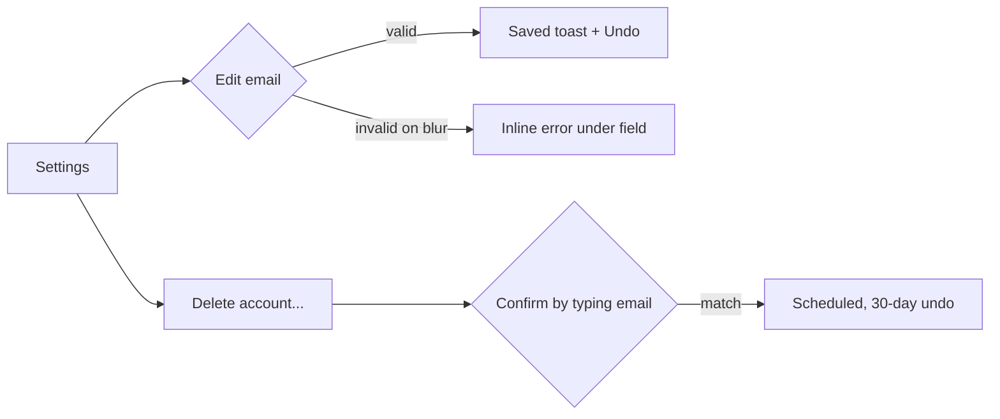

# Hi-fi UI mockups

A mockup is done when every screen in the flow exists at three widths, in light and dark, with
every interactive state shown, real copy, measured contrast and target sizes, a redline spec and a
scored review. Mockups are single-file HTML/CSS that consume token variables: they render
deterministically, diff cleanly in Git and double as hand-off for engineers.

Deep material: settings mockup, render and redline scripts |
review rubrics and report template

## 1. Inputs before pixels

| Input | Form | Missing means |
|---|---|---|
| user goals | 1-3 jobs to be done: "When X, I want Y, so I can Z" | Open doubt; do not invent personas |
| user flow | numbered steps or a mermaid `flowchart` with decision points and error exits | Open doubt |
| screen inventory | one row per screen: purpose, entry points, states (empty, loading, error, success) | derive from the flow, then confirm |
| content model | fields, types, lengths (min, typical, max), counts (0, 1, many), copy owner | ask for real samples; never lorem ipsum |
| constraints | platforms, breakpoints, tokens package, accessibility level (default WCAG 2.2 AA), locales | assume AA and say so |



## 2. Fidelity ladder

| Step | Shows | Freezes | Exit check |
|---|---|---|---|
| 1. grayscale wireframe | layout regions, real copy at real lengths, all screens and states listed | flow, content order, which components exist | every flow step has a screen; no lorem |
| 2. mid-fi | grid, spacing scale, type scale, component shapes, still grayscale | hierarchy, density, breakpoint behaviour | squint test shows one focal point per screen |
| 3. hi-fi | token colours, icons, imagery, motion notes, dark mode | visual design, states, interaction specs | review score (section 10) and the quality gate pass |

Trick: steps 1-3 are the same HTML. The wireframe swaps in a grayscale token block
(`--color-accent-fill: #555; --color-bg-canvas: #F2F2F2; ...`, one font) so the markup never forks.

## 3. Build and render

Rules for the file: one `.html` with inline `<style>`; the first block is the built token CSS
(semantic and component tiers from `design-tokens-dtcg`), then components that use only
`var(--...)` values (an off-scale literal is a review finding); `<meta name="viewport"
content="width=device-width, initial-scale=1, viewport-fit=cover">`; real `<label>`, `<button>`,
`role="switch"` markup so the accessibility checks mean something; no external requests.

| Route | Command | Notes |
|---|---|---|
| Playwright CLI | `npx playwright screenshot --viewport-size=390,844 --color-scheme=dark file://$PWD/settings.html shot-390-dark.png` | also `--full-page`, `--device "iPhone 15"`, `--channel chrome` (use the installed Chrome, no browser download), `--wait-for-timeout 500` |
| script (all variants) | `node render.mjs settings.html` | 3 widths x light/dark + forced colors; uses `page.emulateMedia({ forcedColors: 'active' })` (Chromium only) |
| Playwright MCP (`browser-operator`) | `browser_navigate` -> `browser_resize {width: 390, height: 844}` -> `browser_emulate_media {colorScheme: "dark"}` -> `browser_take_screenshot {filename, fullPage}` | the MCP server blocks `file://` unless started with `--allow-unrestricted-file-access`: serve the folder with `python3 -m http.server 8765 --bind 127.0.0.1 --directory <dir>` |

Widths: 390x844 (phone), 768x1024 (tablet), 1440x900 (desktop). After rendering, **Read every
PNG**; a mockup nobody looked at is not reviewed. Prefer viewport-sized shots for screens with
fixed bars: `--full-page` paints a `position: fixed` tab bar where the first viewport ended, in the
middle of the image. Combine shots with the contact-sheet script for presentation.

## 4. Component state matrix

| State | Trigger | Visual rule | Token(s) |
|---|---|---|---|
| default | none | base appearance | component tokens |
| hover | pointer over (desktop only) | small value or elevation shift; never the only way to reveal an action | `*.bg-hover` |
| focus-visible | keyboard focus | 2 px outline + 2 px offset, 3:1 against both neighbours | `color.focus` |
| active / pressed | pointer down | darker or inset; under 100 ms feedback | `*.bg-active` |
| selected / checked | persistent choice | fill plus a non-colour cue (check, thumb position, weight) | `color.accent.fill` |
| disabled | not available | reduced emphasis (contrast exempt) plus the reason nearby | `color.text.disabled` |
| loading / skeleton | waiting > 300 ms | skeleton blocks at final size; spinner only inside the triggering control | `color.bg.skeleton` |
| error | validation or system failure | message text below the field + icon + 2 px border; `aria-invalid`, `aria-describedby` | `color.danger.fg` |
| empty | zero items | explanation + one next action | |
| success | completed | toast or inline confirmation with Undo where reversible | `color.success.fg` |

Apply per component: buttons (all but empty/selected), inputs (default, hover, focus, disabled,
error, read-only), switches/checkboxes (off, on, focus, disabled on/off), list rows (default, hover,
selected, focus, loading), whole screens (loading, empty, error, success). The matrix is a sheet:
rows = components, columns = states, each cell a rendered crop or "n/a".

## 5. Pattern defaults

- **Navigation**: phone bottom tab bar with 3-5 destinations, labelled icons, current item marked
  by weight or fill plus `aria-current="page"`; from 768 px a side nav (rail or 220-280 px panel).
- **Forms**: one column; label above the field; field height 44-48 px; helper text below; validate
  on blur, not per keystroke; error text says what to do ("Enter an email address with a domain,
  like name@example.com"); required fields marked in text; the primary action names the outcome
  ("Save changes", not "Submit").
- **Tables**: numbers right-aligned in tabular figures (`font-variant-numeric: tabular-nums`),
  sticky header, row actions visible on focus and touch (not hover-only), 40-48 px rows, a
  card list below about 600 px.
- **Modals and sheets**: modal only for blocking decisions; a bottom sheet on phones; title states
  the decision; destructive confirm names the object ("Delete account"); Esc and a visible close.
- **Toasts**: 4-6 s, never for errors that need action, include Undo for reversible changes,
  announced with `role="status"`, placed clear of the tab bar and safe area.
- **Empty states**: what this is, why it is empty, one primary next action; no dead ends.

## 6. Content realism

- Long strings: a 38-character name (`Maximiliane Oyelaran-Featherstonehaugh`), a 60-character
  email, a 3-line notification title; decide wrap, truncate (with full text available) or scale.
- Localisation: containers take +40% length (German, Finnish); RTL mirror check for layout.
- Data counts: 0, 1, 2, many and overflow (99+, 1,284 items) for every list and badge.
- Real errors from the API or spec, real dates and currencies in the target locale.
- Hi-fi never contains lorem ipsum, "Button", "Title" or round fake numbers like 100%.

## 7. Targets and platforms

| Platform | Minimum target | Notes |
|---|---|---|
| Web, WCAG 2.2 SC 2.5.8 (AA) | 24 x 24 CSS px, or spacing so a 24 px circle on each target does not intersect another | exceptions: equivalent control, inline text links, user-agent controls, essential |
| Apple HIG (iOS, iPadOS, watchOS) | default 44 x 44 pt, minimum 28 x 28 pt | macOS 28 x 28 default (20 x 20 min), visionOS 60 x 60, tvOS 66 x 66 |
| Android / Material | 48 x 48 dp, targets separated by 8 dp | a visually smaller control can extend its hit area |

- Text scaling: iOS Dynamic Type (body default 17 pt) and Android font scaling up to 200%
  (Android 14+, nonlinear for large text). Render the key screens at 200% text (`html { font-size:
  200% }` in a test build) and check nothing clips, overlaps or truncates the primary action.
- Safe areas: `padding-bottom: calc(8px + env(safe-area-inset-bottom))` on bottom bars; iOS
  Safari reports the insets only with `viewport-fit=cover`.
- Hit area without visual bloat: keep a 52 x 32 switch and add
  `[role=switch]::before { content: ""; position: absolute; inset: -8px -4px; }` (44 px tall).

## 8. Light, dark and forced colors

Every hi-fi screen ships light and dark renders, plus one forced-colors render on web:

```css
@media (forced-colors: active) {
  .btn-primary { border: 2px solid transparent; }   /* transparent borders become visible */
  [role=switch][aria-checked=true] { background: Highlight; border-color: Highlight; }
  .card { border-color: CanvasText; }
}
```

Check in dark: no pure white on pure black for long text, elevation by lighter surfaces, accent
re-measured (it usually needs a lighter step). Check in forced colors: every control keeps a visible
boundary, focus is visible, state is not carried by background colour alone, icons use
`currentColor`. System colours: `Canvas`, `CanvasText`, `LinkText`, `ButtonFace`, `ButtonText`,
`ButtonBorder`, `Highlight`, `HighlightText`, `GrayText`; opt out only for small previews with
`forced-color-adjust: none`. Measure every text/background pair with `visual-accessibility-audit`.

## 9. Redlines and the spec

Render a redline overlay: [redline.js](references/settings-mockup.md#3-redline-overlay) outlines
each component and labels its size, padding and gap with token names (`pad --space-6`), marking
off-scale values with `!`. Inject it before the screenshot (`page.addScriptTag({ path: 'redline.js' })`)
and limit it with `window.REDLINE_SELECTOR`.

The written spec next to the screenshots lists:

| Section | Content |
|---|---|
| components | name, variant, states used, file or package |
| tokens | every token used per component (`button.primary.bg` -> `color.accent.fill`) |
| layout | grid, breakpoints, max content width, spacing tokens between regions |
| interaction | trigger -> response -> duration and easing token (`motion.duration.fast` 120 ms, `motion.easing.standard`) |
| motion | 100-200 ms for small state changes, 200-300 ms for panels, nothing over 400 ms; `prefers-reduced-motion`: cross-fade or instant |
| accessibility | focus order, labels, live regions, measured contrast pairs, target sizes |
| content | max lengths, truncation rules, empty/error copy |

## 10. Heuristic review

Score each of Nielsen's 10 heuristics 0-3 (0 violated, 1 weak, 2 adequate, 3 strong) with one line
of evidence: 1 visibility of system status, 2 match between system and the real world, 3 user
control and freedom, 4 consistency and standards, 5 error prevention, 6 recognition rather than
recall, 7 flexibility and efficiency of use, 8 aesthetic and minimalist design, 9 help users
recognize, diagnose and recover from errors, 10 help and documentation. Then run the quick
accessibility checks (focus order follows reading order; every input has a visible label; contrast
pairs measured; targets sized; no hover-only or colour-only meaning) and the 10-criterion visual
critique (ship at >= 22/30 with no zero). Report the top fixes ordered by impact, each as
observation (where, measured) -> principle -> fix. Probes per heuristic, the critique rubric and the
report template: review rubrics.

## 11. Worked example: settings screen, phone wireframe to desktop hi-fi

Job: "When my details change, I want to update them and control notifications without contacting
support." Inventory: Settings (profile, notifications, delete account), Delete confirmation dialog,
Saved toast; states: email error, toggle locked by organisation, saving, saved.

1. **Wireframe (390 px)**: profile card (name, email, Save changes), notifications card (3
   switches with helper text), delete card; bottom tab bar Home, Search, Inbox, Settings. Real copy:
   the 38-character name, the error sentence, "Managed by your organisation" on the locked switch.
2. **Draft hi-fi** had two problems found in review: the email field used its placeholder as the
   label, and each row revealed an edit pencil only on `:hover` (`.row .edit { opacity: 0 }
   .row:hover .edit { opacity: 1 }`), invisible on touch and to keyboard users.
3. **Hi-fi**: [settings.html](references/settings-mockup.md#1-settingshtml) with labels above
   fields, inline editable fields instead of hover pencils, 44 px buttons, switches with a 44 px
   hit area, side nav from 768 px, and `max-width: 720px` content.
4. **Render**: `PW_CHANNEL=chrome node render.mjs settings.html` wrote seven PNGs; two contact
   sheets (light, dark) at 390/768/1440 were read and checked.
5. **Measured** (sampled from the renders and recomputed from tokens): Save label `#FFFFFF` on
   `#D63151` 4.75:1; error text `#B91C1C` on white 6.47:1, dark `#FCA5A5` on `#1A1A2E` 8.99:1;
   muted text 6.52:1 light, 6.89:1 dark; input border `#8A8A9A` 3.40:1 (1.4.11); accent link
   `#D63151` on the canvas `#F5F5F7` only 4.37:1, so accent text stays on white cards.
6. **Forced-colors render** showed the primary button as bare text (its background was removed):
   fixed with `border: 2px solid transparent`.

| Heuristic | Draft | Hi-fi | Evidence after the fix |
|---|---|---|---|
| 1 visibility of system status | 1 | 3 | switches apply at once and confirm with a toast; Save shows saving and saved |
| 3 user control and freedom | 2 | 3 | toast Undo; delete has a 30-day undo |
| 4 consistency and standards | 2 | 3 | real `role="switch"`, platform tab bar, one primary action per card |
| 5 error prevention | 1 | 3 | delete asks to type the email; email validated on blur |
| 6 recognition rather than recall | 1 | 3 | labels above fields, no placeholder labels, no hidden edit affordance |
| 9 recover from errors | 1 | 3 | error says what to type and keeps the input |
| 10 help and documentation | 2 | 3 | "Why can't I change this?" on the locked switch |
| others (2, 7, 8) | 6 | 8 | plain words; keyboard reachable; one focal point per card |
| total | 16/30 | 29/30 | |

Top fixes by impact: (1) placeholder-as-label -> visible labels (recall, 1.3.1/3.3.2); (2)
hover-only edit -> always-visible inline editing (touch, keyboard); (3) bare-text primary button in
forced colors -> transparent border; (4) accent link moved off the canvas (4.37 -> 4.75:1).

## Pitfalls

- Lorem ipsum and short names in hi-fi: layouts break on the first real user.
- Hover-only affordances (row actions, tooltips holding required information).
- Placeholder as label: disappears on input, low contrast, not announced as a label everywhere.
- Fixed bars captured with `--full-page`, or screenshots nobody opened.
- `file://` mockups handed to the Playwright MCP server (blocked by default): serve over http.
- One theme reviewed, the other assumed; accent colours tuned on white then reused on the canvas.
- Disabled controls without the reason; error states shown only by a red border.
- Targets measured on the icon, not the hit area; tab bars under the home indicator (no safe area).
- Off-scale spacing literals (13 px) instead of tokens; the redline marks them with `!`.
- Motion specified without a reduced-motion variant.

Related: `design-tokens-dtcg`, `visual-accessibility-audit`, `chart-design-encoding`,
`type-scale-systems`, `layout-grids-posters-editorial`, `browser-automation`,
`react-typescript-components`, `visual-review`, hub `graphic-design`.
